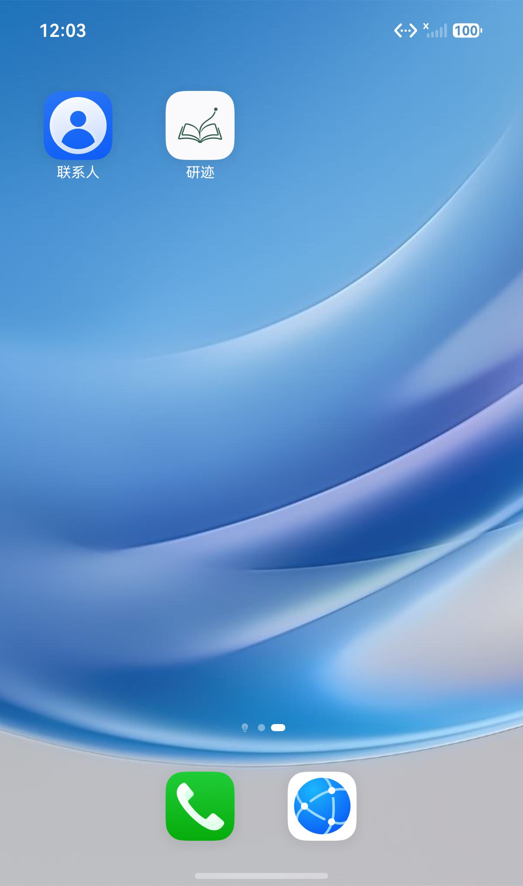

# 应用图标更换验收

2026-10-17，将用户确认的书本与向上轨迹图稿用于各平台应用图标。矢量源及生成方式见 [品牌资源说明](../../assets/branding/README.md)。

| 平台 | 资源与验证 |
| --- | --- |
| 鸿蒙 | AppScope、EntryAbility 及共用启动窗口资源更新为 512 px PNG；未签名预览 HAP 构建、`install -r`、启动与桌面显示通过 |
| iOS / iPadOS | 既有 AppIcon 清单 19 项尺寸检查通过；所有 PNG 为不透明 RGB；Xcode 26.6 actool 以 iphonesimulator 目标编译通过 |
| Android | 五档密度 PNG、API 26 自适应矢量图标、API 33 单色主题图标；SDK 36 aapt2 对资源编译和链接通过 |
| macOS | 既有 AppIcon 清单 10 项尺寸检查通过；透明边距与圆角底板；actool 以 macosx 目标编译通过 |
| Windows | ICO 含 16、24、32、48、64、128、256 px 七档尺寸，文件读取与尺寸检查通过 |

鸿蒙使用 `Yanji_API26_Validation` API 26 ARM64 实例。实际桌面显示新图标，点击后进入正式 App，主进程启动日志没有 Flutter 异常。

安装前先暂停正在进行的学习，保留 30 分 58 秒（1,858,811 ms）。安装重启后沿用现有规则按 checkpoint 结算：前后均为 44 条 session，所有 segment 完全一致，SQLite integrity_check 通过。没有卸载、清空数据或更改包名。数据库备份和原始构建日志保存在被忽略的 `work/branding/` 中。

本次只改变图标资源与生成工具，不改变业务代码。Apple、Android 的验证针对图标资源编译；Windows 未执行整包构建，鸿蒙以外的平台本轮没有重新安装设备验收。
