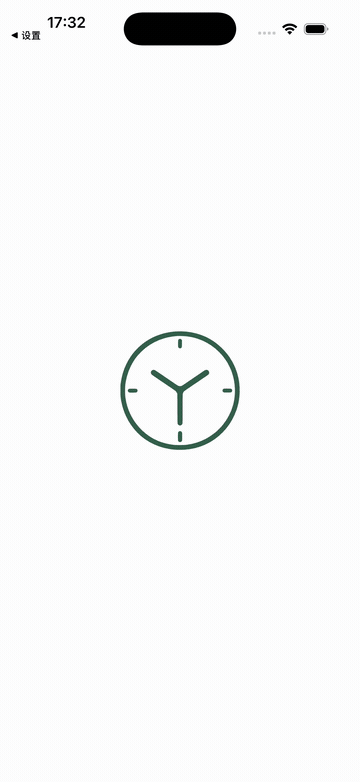
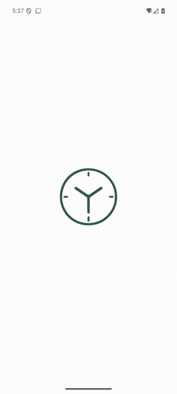

# iOS／Android 启动动画重验

本轮针对时钟镂空启动动画，复用 `integration_test/startup_reveal_test.dart` 验证真实设备后端，并单独覆盖安装完整 `lib/main.dart` 入口录制冷启动。所有安装均保留已有模拟器与应用数据。

## 验收结果（2026-10-17）

| 平台 | 环境 | 设备用例 |
|---|---|---|
| iOS | iPhone 17 Pro，iOS 26.5 ARM64，Flutter 3.47.2，Impeller Metal | 10 项通过 |
| Android | API 36 ARM64，Flutter 3.47.2，Impeller OpenGLES，宿主 Apple M1 Pro GPU | 10 项通过 |
| 鸿蒙回归 | API 26 ARM64，Flutter 3.41.9 OHOS，Skia | 9 项绘制／交互用例通过，完整入口进入今日页 |

数字均为实质用例，不包含框架收尾。主机全量 **254 项通过**，固定 OHOS SDK 静态检查无问题。iOS／Android 的原生伴随工具检查 PID 保持，并由设备断言确认保留“我的”页面、不重播遮罩、返回今日页可操作；工具与 driver 均成功。减少动态效果、错误重试与三个屏幕尺寸的结束帧全部无遮挡也通过。

验收前后 iOS 预览数据库的 84 条会话／84 条分段、Android 的 42 条会话／42 条分段内容均一致，SQLite 完整性检查通过。完整预览入口已恢复，无测试触点。原始日志、原生录屏和数据库比对副本位于忽略的 `work/startup-reveal/cross-platform/`，不提交用户数据。指标见 [JSON 记录](validation/startup-reveal-cross-platform.json)。

完整入口的原生录屏演示：

| iOS | Android |
|---|---|
|  |  |

GIF 从系统原生录屏截取静止时钟至完整首页，保留原时间顺序并缩至 360 像素宽。iOS 录屏源为 1206 × 2622；Android 系统录屏为 540 × 1200，另存 1080 × 2400 的完整末页截图。阶段证据：[iOS 静止](screenshots/startup-reveal/ios/hold.jpeg)、[镂空](screenshots/startup-reveal/ios/window.jpeg)、[放大](screenshots/startup-reveal/ios/expanding.jpeg)、[末页](screenshots/startup-reveal/ios/today.jpeg)；[Android 静止](screenshots/startup-reveal/android/hold.jpeg)、[镂空](screenshots/startup-reveal/android/window.jpeg)、[放大](screenshots/startup-reveal/android/expanding.jpeg)、[末页](screenshots/startup-reveal/android/today.jpeg)。

Android 先前的 SwiftShader 软件渲染模式通过功能断言，但录屏有明显停顿；最终在同一个 AVD 上用 `-gpu host` 重启，系统 GLES 报告宿主 Apple M1 Pro，再次跑完 10 项用例并录制完整主应用，能看到连续的放大过程。没有清除 AVD 或应用数据，也未修改光学 shader 或降低像素断言。额外启动的 iOS／Android 模拟器验收后关闭，已安装的完整预览 App 保留，鸿蒙模拟器继续停在今日页。

## 本轮修正

原先 iOS 的 LaunchImage 还是 1 像素透明占位图；Android 使用默认启动背景，API 31+ 还会选取带底板的桌面图标。现在 iOS 从标志 SVG 导出透明启动图，Storyboard 约束为 192 pt；Android 从同一组路径生成专用 VectorDrawable，并为 API 31+ 的 288 dp 系统画布添加安全边距，使系统与 Flutter 的 192 dp 画布对齐。Android 浅色与深色启动资源分别覆盖，避免夜间资源优先级选回默认桌面图标。API 31+ 在 Flutter 首帧触发系统退出回调时直接撤下原生标志，避免重复退出动画。

尺寸与系统边界参考 [Android SplashScreen 官方说明](https://developer.android.com/develop/ui/views/launch/splash-screen)；iOS 按 [Flutter 启动页配置](https://docs.flutter.dev/platform-integration/ios/launch-screen)使用 LaunchScreen Storyboard。iOS 原生使用透明 PNG，Android 使用矢量 XML，Flutter 揭幕使用矢量路径，三者均来自同一 SVG 源，不含桌面图标底板。

Android 首轮设备验收发现生命周期过渡可能产生零尺寸绘制区域，导致 `0 × Infinity` 路径变换；现在直接跳过空区域绘制，新增三种空尺寸的回归断言，保留所有原有像素阈值。

首次录屏还发现：Dart 的 post-frame 回调只表明页面已提交，冷启动实际栅格化尚未完成，计时器已开始推进。现在保留静止时钟，等待目标页面对应的 `FrameTiming` 栅格回报后才开始 950 ms 揭幕，不使用固定延时。回报由引擎批量发送，交付时机见 [Flutter 官方说明](https://api.flutter.dev/flutter/rendering/RendererBinding/addTimingsCallback.html)。失败或销毁时移除回调，重试不会被旧请求触发；减少动态效果仍直接显示就绪页面。主机 Widget 测试使用可控栅格完成信号，设备完整 App 保留真实引擎回报。

## 复现

使用标准 Flutter 3.47.2。切换 SDK 前保存锁文件；该 SDK 需要它固定的五个基础依赖版本，验收结束后恢复本分支 OHOS 锁文件与包配置。不要在一个工作目录中并发切换两套 SDK。

第一终端运行原生前后台伴随工具；Android 使用 adb serial，iOS 使用 Simulator UDID，工具等待就绪标记后操作系统：

```sh
python3 tool/verify_startup_resume.py --platform android --device <serial> \
  --log work/startup-android.log --output work/startup-android-native
# iOS 改为 --platform ios --device <simulator-udid>
```

第二终端运行同一套设备用例。`work/startup-android.log` 必须是本轮新建或截断的日志；iOS 使用对应的新日志路径。构建号应不低于已安装版本，避免自动卸载降级：

```sh
YANJI_REFERENCE_OUTPUT=work/startup-android \
flutter drive -d <device-id> --driver=test_driver/glass_ui_driver.dart \
  --target=integration_test/startup_reveal_test.dart \
  --dart-define=YANJI_PREVIEW=true --build-number=28 --keep-app-running \
  >work/startup-android.log 2>&1
```

这组用例检查数据就绪、真实栅格门控、点击拦截与恢复、初始化失败重试、减少动态效果、空尺寸、镂空像素和三种完整覆盖尺寸；最后进入预览 App、点击“我的”、由系统切后台并返回，检查原路由和进程保留、启动遮罩不重播，再点击今日导航。原生伴随工具与 Flutter driver 均成功才算通过，不能仅凭发出系统命令判定成功。

结束后用 `lib/main.dart`、相同预览开关及不降低的构建号恢复完整 App；iOS 使用 `simctl install`，Android 使用 `adb install -r`，不得卸载或清除既有数据。本机的 Xcode 启动器兼容处理沿用[三端界面验收](ui-reacceptance.md)中记录的本地 Developer 镜像，未修改系统 Xcode。

## 边界

验收对象是 iOS 26.5 ARM64 和 Android API 36 ARM64 模拟器，使用 Debug 构建。录屏用于确认启动图衔接、真实页面镂空和放大过程，不能作为发布包真机帧率、功耗或所有系统版本的性能结论。本轮没有重新运行与启动无关的三端玻璃光学全量验收。

标准 SDK 的初始静态检查有两项已有提示：`axisAlignment` 弃用和扫码包 Web 代码的 JS 互操作类型检查；本轮未修改这两处。构建保留已有 Kotlin 迁移提示和不适用于 Skia 的光学 shader 告警，本次原生运行使用上述 Impeller 后端；未将这些构建告警当作启动动画设备失败，也未改用磨砂降级来规避验收。
