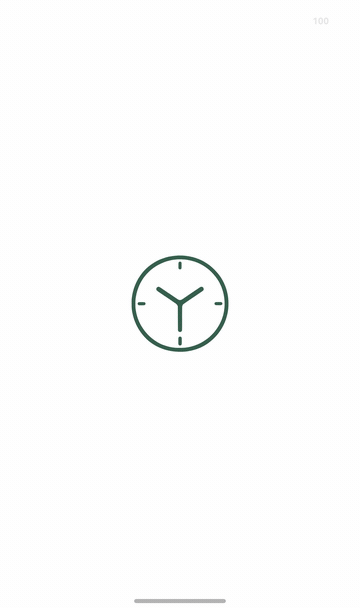

# 时钟镂空启动动画验收

2026-10-17：API 26 ARM64 鸿蒙模拟器验收通过。冷启动先保留绿色 Y 字时钟，初始化完成并绘制目标页面后，表盘内部显露真实页面，窗口逐渐放大至覆盖屏幕，绿色轮廓与指针淡出。揭幕阶段为 950 ms；初始化期间没有固定等待时长，也不等待网络同步。



此 GIF 来自模拟器原生截图，按采集时间间隔播放，宽度缩至 360 像素。截图采集有开销，不能作为帧率或启动性能基准。

## 实现与衔接

- `lib/app/startup_reveal.dart` 在应用初始化状态之外保持同一个遮罩。`appControllerProvider` 成功返回后，等待目标页面首帧布局与绘制，再启动动画；首次使用时目标是引导页，已有工作区时是首页。
- 白色遮罩使用矢量路径差集挖出时钟内轮廓，下面是实际挂载的页面；没有截图替身、位图标志或额外片元着色器。动画结束前拦截点击并隐藏底层无障碍节点，避免误操作。
- 开启减少动态效果或无障碍导航时，仍等待数据与页面就绪，但跳过放大。初始化失败直接展示原有错误与重试界面；重试可以重新初始化。进后台再返回不会重播。
- 标志路径由 `tool/generate_app_icons.py` 从应用图标 SVG 同步生成到 `lib/design/branding/yanji_mark_paths.dart`。时钟第一条路径的第二个闭合轮廓定义透明窗口，图案与桌面图标使用同一几何源。
- 鸿蒙系统启动窗口与 ArkUI `FlutterPage.splashScreenView` 使用同一透明 SVG，后者由 SDK 的 `onFirstFrame` 自动撤下，填补系统窗口结束至 Flutter 首帧之间的空档。两者及 Flutter 静止标志均按 512 物理像素画布居中。

## 验收结果

| 验收 | 结果 |
|---|---|
| 静态检查 | `analyze --no-pub` 无问题 |
| 全量主机测试 | 252 项通过 |
| 鸿蒙设备测试 | 7 项实质用例通过；日志的第 8 项是框架收尾 |
| 像素验证 | 内部显示底层颜色、外部保持白色、窗口持续扩大；三种横竖屏尺寸的结束帧全部像素无遮挡 |
| 交互与故障 | 就绪前及动画期间不可点击；结束后可点击；失败可重试；减少动态效果跳过缩放 |
| 正式入口冷启动 | 未签名 HAP 构建及覆盖安装成功，采集 50 张原生窗口截图，进入真实今日页 |
| 原生到 Flutter 衔接 | 连续 14 张静止阶段截图均有同位置时钟，图案边界为 `[483, 938, 838, 1291]`（1320 × 2232 屏幕）；未采到中间白屏 |
| 前后台切换 | 从“我的”页回桌面再返回，同一进程保留原路由，未重播动画；最后返回今日页 |
| 数据保护 | 预览数据库前后均为 44 条学习会话、44 条分段，内容一致，SQLite `integrity_check` 通过 |

设备测试入口只运行交互与绘制用例，不打开数据库或平台身份。测试后已覆盖安装回完整预览 App；全程不卸载应用。正式入口日志未发现 `EXCEPTION CAUGHT` 或着色器编译错误。

阶段截图：[静止时钟](screenshots/12-startup-clock-hold.jpeg)、[镂空窗口](screenshots/13-startup-clock-window.jpeg)、[放大中](screenshots/14-startup-clock-expanding.jpeg)、[完整首页](screenshots/15-startup-clock-complete.jpeg)。汇总见 [JSON 记录](validation/startup-reveal.json)。原始测试日志、50 帧截图与数据库比对副本保存在被忽略的 `work/startup-reveal/`，不提交用户数据。

## 复现

使用本分支固定的 Flutter OHOS SDK 和已解锁的 API 26 ARM64 模拟器：

```sh
tool/flutter_ohos.sh analyze --no-pub
tool/flutter_ohos.sh test --no-pub
tool/build_harmonyos_unsigned.sh integration_test/harmonyos_startup_reveal_test.dart
hdc -t <device> install -r ohos/entry/build/default/outputs/default/entry-default-unsigned.hap
hdc -t <device> shell aa force-stop com.example.yanji
hdc -t <device> shell aa start -a EntryAbility -b com.example.yanji
```

设备日志应包含七项用例及 `All tests passed!`。随后恢复完整入口；以下开关使用独立预览数据库，适合验收已有 mock 工作区：

```sh
YANJI_DART_DEFINES=WUFOSklfUFJFVklFVz10cnVl tool/build_harmonyos_unsigned.sh
hdc -t <device> install -r ohos/entry/build/default/outputs/default/entry-default-unsigned.hap
hdc -t <device> shell aa force-stop com.example.yanji
hdc -t <device> shell aa start -a EntryAbility -b com.example.yanji
```

观察冷启动时钟、镂空、放大与落地页面，再切后台返回检查不重播。已有模拟器应使用覆盖安装，避免卸载影响 HUKS 身份。

## 边界

本页记录首轮鸿蒙 API 26 ARM64 模拟器验收；后续已补齐 [iOS／Android 重验](startup-reveal-cross-platform.md)，并新增实际栅格门控与空尺寸回归。未做鸿蒙真机或最低支持版本验收。截图表明采样点没有白屏，不构成每个显示帧均被捕获或无掉帧的结论。
