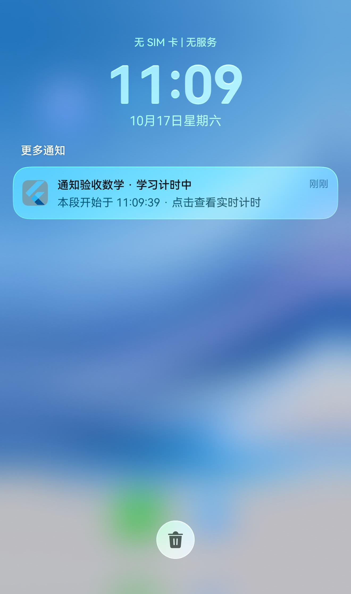

# 鸿蒙计时通知与实况胶囊

更新：2026-10-17。普通计时通知已实现并在 API 26 ARM64 模拟器验收；Live View Kit 已完成接入调研，尚未接入、申请场景权益或验收胶囊显示。

## 本次修复

原先 Dart 的 `StudyLiveActivity` 只放行 iOS/Android，鸿蒙入口也没有注册 `com.example.yanji/study_live_activity` 处理器。现在补齐 OHOS 平台判断，以及 `StudyNotificationPlugin` 的 Notification Kit 实现，复用已有 controller 快照与生命周期，不改变学习时长的计算、暂停和恢复规则。

| 操作 | 系统通知行为 |
| --- | --- |
| 首次开始学习 | 在前台申请通知授权；允许后发布一条安静通知 |
| 前台计时 | 显示科目、累计时长及快照时间，每秒更新同一条通知 |
| 退到后台 | 显示“本段开始于 HH:mm:ss · 点击查看实时计时”，停止应用内刷新定时器 |
| 暂停 | 显示“已暂停”与固定累计时长 |
| 恢复 | 继续累计，不计入暂停时间 |
| 点击 | WantAgent 返回 EntryAbility；消费一次 `open` 事件，沿用 Flutter 计时路由与返回栈 |
| 结束 | 清除本应用的计时通知；过时快照不能重新创建通知 |

通知 ID 为 `42017`、label 为 `yanji.study`；重复更新不堆叠，不清除应用的其他通知。`CONTENT_INFORMATION` 使用安静通知槽，模拟器显示在通知中心的“更多通知”下；没有额外开启横幅、声音、振动或申请后台保活权限。拒绝通知不阻断学习和数据库保存；重新开启需进入系统应用通知设置。

本机 SDK 26 的 `notificationRequest.d.ts` 明确将 `isStopwatch`、`isCountDown`、`isOngoing`、`isUnremovable` 标为尚未实现。因此普通通知没有伪装成系统秒表：后台保留可解释的时间锚点，实时累计以学习页为准。SDK 中系统实况通知的计时字段也不能当作第三方任意发布权限使用。[Notification Kit 概述](https://developer.huawei.com/consumer/cn/doc/harmonyos-guides-v5/notification-overview-V5)与[定时器后台冻结说明](https://developer.huawei.com/consumer/cn/doc/harmonyos-references-V14/js-apis-timer-V14)提供背景。

普通通知不保证进程存活。硬杀进程不能依赖 `onDestroy` 回调：下次启动会按已有规则结算 checkpoint 并清理通知，原生通知另设最长约 8 小时自动过期边界；这不是进程结束即自动移除的系统级保证。真机后台策略和最低支持系统仍待验收。

## 本机验收

设备：`Yanji_API26_Validation`，HarmonyOS API 26 ARM64。结果见[结构化报告](validation/study-notifications.json)。

- 实际系统授权弹窗允许后，通知中心出现计时通知；Home 退后台后保留时间锚点。
- 前台累计增长、暂停冻结、恢复增长、结束清除、过时快照忽略均通过设备断言。
- 实际点击系统通知返回应用，`consumePendingAction` 返回一次 `open` 后清空。
- 正式 App 另通过相同 Want 参数验证真实计时路由和 Back 返回今日页，未插入验收学习记录。
- `flutter analyze --no-pub` 无问题；5 项平台通道回归与 5 项计时安全回归通过。主机测试不代替原生通知验收。
- 已重新安装正式 `lib/main.dart` 预览 HAP。升级前暂停的 11 分 08 秒按 checkpoint 结算，前后 43 条 session 一致、所有 segment 不变、SQLite integrity_check 通过。验收 fixture 使用内存库；数据库备份只保存在被忽略的本地工作目录。

通知中心实际截图：




复现需要已解锁模拟器；以下脚本会以 `install -r` 替换当前应用入口，不卸载应用。开始前暂停正在进行的学习，安装重启会按现有恢复规则结算。

```sh
tool/build_harmonyos_unsigned.sh integration_test/harmonyos_study_notification_test.dart
python3 tool/probes/harmonyos_study_notification_acceptance.py \
  <hdc-device> <emulator-instance> /absolute/path/to/command-line-tools

# 验收后恢复正式入口；当前预览实例使用该显式开关，业务库仍独立保存。
YANJI_DART_DEFINES=WUFOSklfUFJFVklFVz10cnVl tool/build_harmonyos_unsigned.sh
<hdc> -t <hdc-device> install -r ohos/entry/build/default/outputs/default/entry-default-unsigned.hap
<hdc> -t <hdc-device> shell aa force-stop com.example.yanji
<hdc> -t <hdc-device> shell aa start -a EntryAbility -b com.example.yanji
```

fixture 的本地 HTTP 验收门只存在于集成测试入口，绑定设备 loopback，使用临时 hdc 端口转发；正式入口没有该服务。脚本保留系统通知截图与设备日志，并清理自己的转发规则。

## “上岛”的接入结论

推荐使用华为 **Live View Kit 的 `TIMER` 场景 + 计时器实况胶囊**。胶囊在状态栏呈现，卡片可覆盖通知中心、锁屏等系统入口，最终形态由系统决定。能力介绍见 [Live View Kit](https://developer.huawei.com/consumer/cn/sdk/live-view-kit)。

[官方场景说明（2025-05-20，V14）](https://developer.huawei.com/consumer/en/doc/harmonyos-guides-V14/liveview-introduction-V14)将 `TIMER` 用于专注、番茄钟等，并写明限工具类应用、计时场景只能在设备侧创建和更新。研迹同时具有学习管理属性，必须先核实所选应用分类是否满足当前 TIMER 权益要求，不能仅凭 API 能编译就认为可发布。同一版说明还规定不支持模拟器及最长 8 小时活动周期；这些版本化约束需在正式申请时复核。当前模拟器 `liveViewSyscap=true` 只说明系统声明了能力，不构成胶囊可用或权益已获批的证据。

### 开发前的准备

1. 确定正式 bundle name、AGC 应用身份及对应签名，当前仍是 `com.example.yanji`。
2. 在 AGC 开通 Live View Kit，并核实／申请 **TIMER 场景权益**；系统实况窗开关也必须开启。
3. 使用真机联调。官方提供设备白名单先行调试，再提交效果材料申请正式权限；白名单按 Push Token 录入，这不等于本地计时需要云端服务。[接入联调测试](https://developer.huawei.com/consumer/cn/doc/harmonyos-guides-v5/liveview-joint-commission-test-V5)
4. 准备原生 rawfile 图标与卡片文案，按系统模板约束设计；胶囊不直接嵌入 Flutter Widget。

### 与现有代码的对应方式

[本地构建指南](https://developer.huawei.com/consumer/cn/doc/harmonyos-guides-v5/liveview-create-locally-V5)介绍 `startLiveView`、`updateLiveView`、`stopLiveView` 和胶囊参数；创建必须源于应用前台的用户服务行为。研迹可从“开始学习”创建，在暂停／恢复／结束时更新，无须每秒从 Dart 发送一次消息。

本机 **SDK 26.0.0.105** 的 `hms/ets/api/@hms.core.liveview.liveViewManager.d.ts` 已核对如下字段，后续实施以对应 SDK 声明及当前官方权益要求为准：

| 现有状态／职责 | Live View Kit 映射 |
| --- | --- |
| 开始学习 | `event: 'TIMER'`，`startLiveView` |
| 计时卡片 | `LiveView.timer`，文案字段使用字面量 `${placeholder.timer}` |
| 状态栏胶囊 | `liveViewData.capsule`，`CapsuleType.CAPSULE_TYPE_TIMER` |
| 有效累计时长 | 两处 `time` 都传毫秒时长，不能传 Unix 起始时间戳 |
| 暂停／恢复 | 两处 `isPaused` 一致，正向计时 `isCountdown: false`，`updateLiveView` |
| 结束 | `stopLiveView`；仅在系统确认创建成功后记录本地映射 |
| 点击 | 复用本次 WantAgent 与 `open` 路由处理 |
| 时序 | 持久化单调递增 `sequence`，更新和结束必须大于当前版本 |
| 活动标识 | `id` 是 int32 数字；可用独立 ID `42018` 对应唯一进行中 session，并持久化 session UUID 映射；不能直接把 UUID 当作系统 id |

每次同步以同一瞬间计算两处时长：活动时 `elapsedSeconds * 1000 + max(0, nowMs - snapshotAtMs)`，暂停时只用固定累计量。系统负责展示时跳秒，Dart/SQLite 仍是业务时间来源。应用被挂起不会因胶囊而获得执行保证。

API 26 新增 `lifeCycleMode: AUTO_STOP_WHEN_APP_TERMINATE`，适合研迹当前“进程结束后按最后 checkpoint 结算”的规则。默认 `STOP_BY_APP` 不会随进程自动结束，不能省略后假设系统会清理。最低支持 API 17 没有此新增字段，需要版本判断、正常结束显式 stop 和冷启动残留清理；异常退出的即时清理能力需单独评估。

系统活动的墙上时间上限与研迹“最多 8 小时有效学习”不是同一回事：中途暂停很久，系统窗口可能先到期。届时让胶囊结束／降级为普通通知，学习记录仍按实际规则结算，不能为维持窗口伪造新活动。到期、开关关闭、权益失败及用户主动清除也都应走可解释的降级路径。

建议后续顺序：**确认分类和 TIMER 权益 → 真机白名单 → 原生本地计时卡片／胶囊 → 接共享 Flutter 状态 → 真机后台、杀进程、长暂停与 8 小时边界验收**。当前先保留已验证的普通通知实现；尚未添加未获权益、无法验收的胶囊发布调用。
