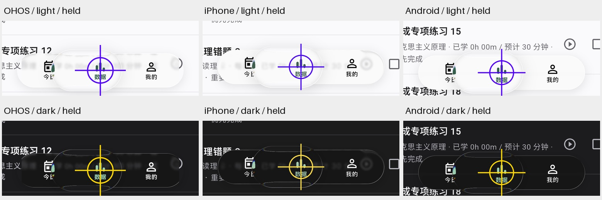

# 三端界面重新验收

2026-10-17 整理；最终设备用例于 10 月 16 日晚完成。本轮补齐 iPhone 的真实运行验收，三端均通过同一套 7 个设备场景，各保存 67 张原生窗口截图。框架显示的 `+9` 包含 setUpAll / tearDownAll。

| 平台 | 环境 | 结果 |
| --- | --- | --- |
| 鸿蒙 | API 26 ARM64，Flutter 3.41.9+ohos-1.0.2，Skia 当前帧背景采样 | 7/7，通过 |
| iPhone | iPhone 17 Pro / iOS 26.5 ARM64，Flutter 3.47.2，Impeller Metal | 7/7，通过 |
| Android | API 36 ARM64，Flutter 3.47.2，Impeller OpenGLES | 7/7，通过 |

三端本次进程的运行日志中，Flutter 异常、shader 编译错误与 SkSL 错误均为 0。主机全量 240 项通过（4 分 47 秒），OHOS SDK 静态检查无问题。上游 Flutter 3.47.2 的初始静态检查另提示既有 `axisAlignment` API 弃用，不属于本轮界面故障。

## 实际检查了什么

`glass_ui_reacceptance_test.dart` 复用完整光学验收并进入正式 `app.main()`。开启 `YANJI_PREVIEW=true`，使用独立的持久化 mock 数据库，保留各模拟器已有数据。

- 原导航的凸起透镜几何、图标输入放大、折射方向、栏体上下及两端收缩。
- 通用玻璃的边缘放大衰减与屏幕底部背景采样位置。
- 中性背景上的实际色散像素，以及仅背景重绘后的实时采样更新。
- 浅色、深色真实分段控件拖动时启用完整玻璃层，未进入 FakeGlass。
- 共用面板、下拉菜单、分段控件、弹窗、按钮及提示同时运行。
- 正式今日页 → 拖动导航 → 统计页 → 日／周／月 → 我的页面；两种主题各跑一遍，检查按住时的完整材质、松手后压力恢复及真实路由提交。

正式统计页会保留滚动位置。用例先确认进入 `StatisticsPage`，再将分段控件放到可操作的位置；不以屏幕外的懒构建标题判断路由失败。Android 每个用例单独转换截图 surface，因为 integration_test 会在用例结束时自动还原；iOS／OHOS 上该操作为空操作。上述处理没有改变光学断言或降低像素阈值。

## 光学对照

| 指标 | 鸿蒙 | iPhone | Android |
| --- | ---: | ---: | ---: |
| DPR | 3.0 | 3.0 | 2.625 |
| 透镜高度（dp） | 72.00 | 72.00 | 72.00 |
| 图标输入放大比例 | 1.2083 | 1.2083 | 1.1905 |
| 边缘标记向外位移（dp） | 1.0336 | 1.0589 | 0.9524 |
| 栏体上／下收缩（dp） | 3.000 / 3.000 | 3.000 / 3.000 | 3.048 / 3.048 |
| 两端收缩（dp） | 3.667 | 3.667 | 3.429 |
| 透镜内／外栏体高度比 | 0.8929 | 0.8929 | 0.8904 |
| 关闭光学后的色散像素 | 0 | 0 | 0 |
| 开启光学后的色散像素 | 1895 | 2228 | 2226 |

几何与位移差异处于一个物理像素的取整范围内，全部满足原断言。色散计数受 DPR 和 GPU 采样影响，用来验证光学已生效，不要求三端计数相等。背景内容、屏幕高度、安全区和既有 mock 记录也不同，因此不把整页截图相同或哈希相同作为跨端通过条件。

按住导航的真实页面局部对照（从原始窗口截图裁剪，按逻辑尺寸统一展示）：



十字圆圈是 Flutter 测试触点；正式主应用没有此标记。原始完整截图保存在 [鸿蒙](screenshots/ui-reacceptance/ohos/)、[iPhone](screenshots/ui-reacceptance/ios/)、[Android](screenshots/ui-reacceptance/android/)；每端包含浅深色导航按住、浅深色统计分段拖动和中性色散场景。

完整指标：[鸿蒙](validation/ui-reacceptance-ohos.json)、[iPhone](validation/ui-reacceptance-ios.json)、[Android](validation/ui-reacceptance-android.json)。原始日志和全部截图位于忽略的 `work/harmonyos/ui-ohos-final`、`ios-ui-final`、`android-ui-final`。

## 本轮兼容修正

真实 App 的 iOS 编译发现，所选鸿蒙扫码 fork 在 Dart 中直接引用 `TargetPlatform.ohos`，标准 Flutter 没有该枚举成员。将固定提交的源码收进 `packages/mobile_scanner`，三个判断改用 `defaultTargetPlatform.name`；原生扫码实现保持，OHOS 仍使用 ScanKit。来源、许可和修改范围见该包的 `YANJI_PATCHES.md`。

项目明确使用 CocoaPods 安装 iOS 插件，匹配尚不支持 SwiftPM 的内嵌 Syncthing 插件，并锁定实际安装的完整插件列表。本机 Xcode 的 arm64e 启动器不能加载其 arm64 `libxcrun`；验收使用项目内忽略目录中的临时 Developer 镜像，转用兼容的 Command Line Tools `libxcrun`，直接构建 ARM64 模拟器目标。没有修改系统 Xcode、全局 SDK 或 Flutter 配置。

## 复现

鸿蒙（先启动并解锁模拟器，用 `hdc list targets` 取得本次连接地址）：

```sh
YANJI_DART_DEFINES=WUFOSklfUFJFVklFVz10cnVl \
YANJI_GLASS_OUTPUT=ui-ohos-final \
YANJI_GLASS_TEST_TARGET=integration_test/glass_ui_reacceptance_test.dart \
tool/run_harmonyos_full_glass.sh <hdc-target>
```

iPhone／Android 在可用的标准 Flutter 和原生工具链上运行同一入口：

```sh
YANJI_REFERENCE_OUTPUT=work/harmonyos/ui-reference \
flutter drive -d <device-id> \
  --driver=test_driver/glass_ui_driver.dart \
  --target=integration_test/glass_ui_reacceptance_test.dart \
  --dart-define=YANJI_PREVIEW=true --keep-app-running
```

在已有 Android 数据的模拟器上，先检查已安装版本；若新包版本较低，先显式构建版本不低于现有 App 的 APK，再用 `adb install -r` 覆盖，避免 Flutter 自动回退卸载。本轮全部安装都使用覆盖方式，没有卸载或清除任何模拟器数据。

切换上游与 OHOS SDK 前应保留对应锁文件，再运行该 SDK 的 pub get，不要在同一工作目录并发切换 package_config。验收完成后，以 `lib/main.dart` 和相同 preview 开关恢复主应用。

本次三端均已恢复 preview 主应用，并由系统截图确认正常页面。鸿蒙保留运行，停在统计月视图，累计学习仍为 35h32m、14 个学习日；跨日后的今日计数按新日期显示。[恢复后的正式统计页](screenshots/ui-reacceptance/ohos/app-restored.jpeg)没有测试触点。额外启动的 iPhone／Android 模拟器已关闭。锁文件和包配置已恢复 OHOS SDK 基线。

本轮结论覆盖这三台模拟器的界面与交互；真机帧率、功耗与不同 GPU 仍需后续真机验收。
