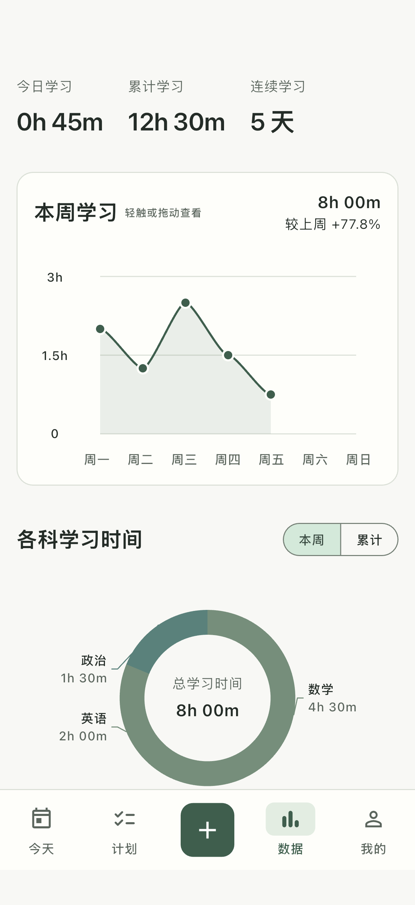
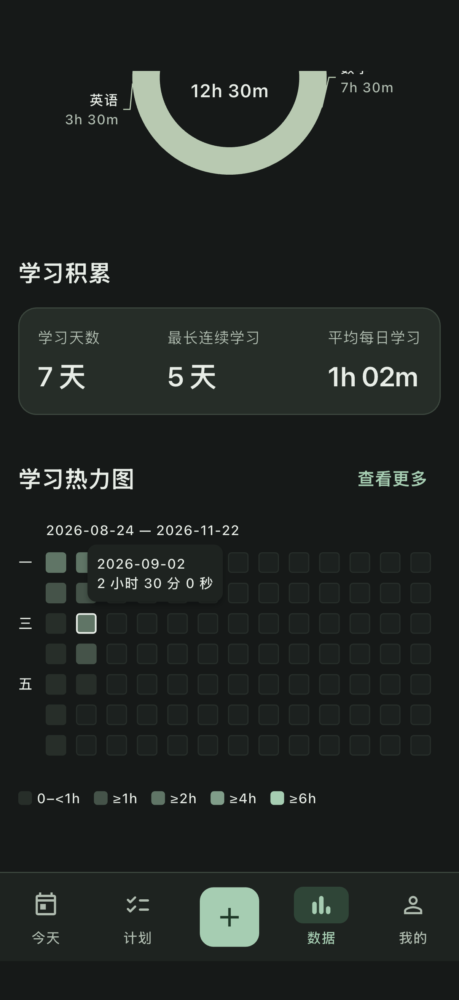
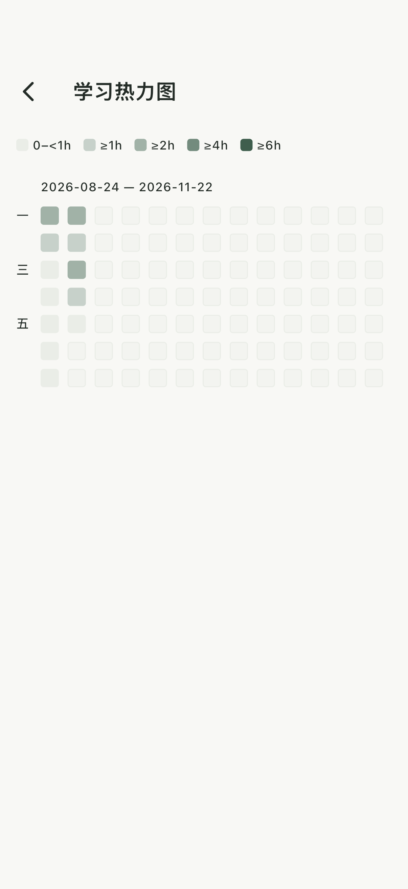
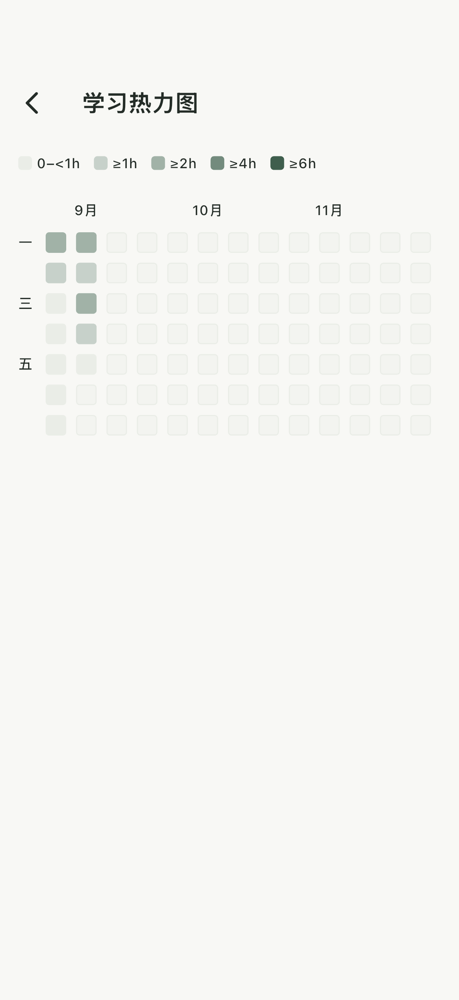

# 连续学习热力图与数据页调整 · 2026-09-04

本轮以最新用户补充为准：数据页最多显示两行，即约半年的记录，其余进入“查看更多”浏览。

- 周趋势的小字提示紧邻标题，补充自适应分钟/小时纵轴。点按精确时间提示仍在图内。
- 科目圆环与外围标签为静态展示，取消点按浮层、提示和选中效果。
- 学习积累三项分散对齐，窄屏和大字体允许换行。
- 首次正时长记录日为热力图第一格；此后每个自然日连续排列，无记录日期也绘制低档颜色。固定每行 91 天（13 周，约三个月），末行补浅色未来占位。无学习记录时显示简短空态和一行占位。
- 数据页显示最初最多两行，右上角“查看更多”进入独立全屏列表。全屏从第一天起按顺序加载所有行，支持多年纵向浏览、触摸查看日期时长及返回数据页。
- 五个颜色档位按达到的最高阈值确定：不足 1h、≥1h、≥2h、≥4h、≥6h；图例第一档显示 0–<1h。删除原底部时区说明。
- 继续直接使用 StudyStatistics.daily；没有新增统计真值、表或写入。

验证：24 项应用/组件回归通过；最终图表与热力图定向测试 7 项通过；覆盖首日对齐、无前置空格、跨年、闰日、91/92 天行边界、两行上限、五级边界、多年完整页面滚动与返回、320 宽/200% 字号深色图表。

截图使用隔离内存数据库中的合成记录，不代表用户实际学习数据，未修改用户数据库。

原生集成测试通过（浅色/深色趋势触摸、圆环范围切换、热力图精确日期浮层、查看更多与返回）。

Flutter analyze 无问题；iOS 模拟器 Debug 与 Android Debug APK 构建成功。已重新安装并启动普通 iOS 应用，保留现有设备数据。

## 后续微调：顶部对齐与月份标注

顶部三指标分散对齐，科目切换按钮边框使用浅色 outlineVariant。热力图预览和完整页面移除日期范围，在每月一号所在列上方显示月份。7 项组件回归与原生集成通过，analyze 无问题，iOS/Android Debug 构建成功，普通 iPhone 应用已更新并保留数据。

