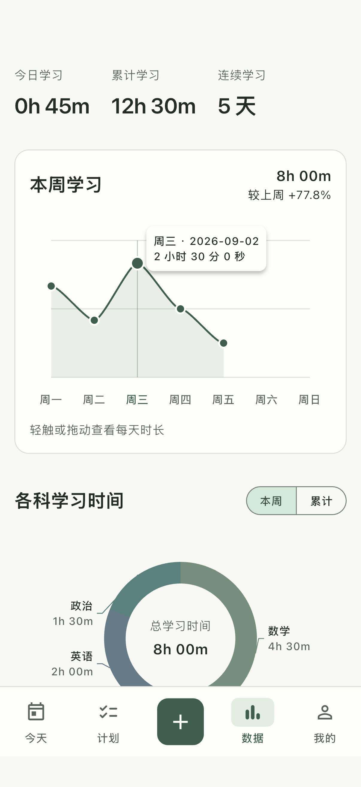
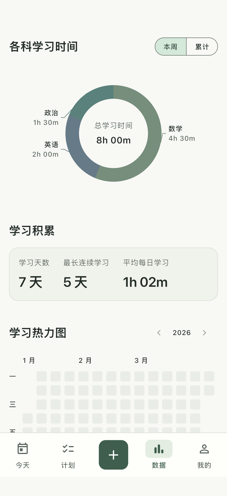
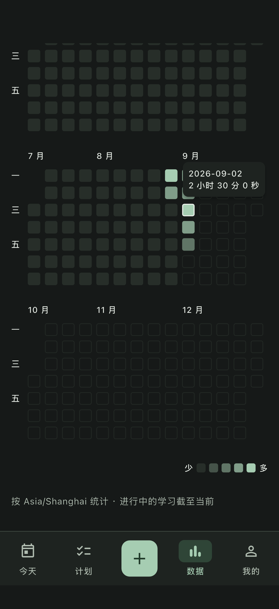

# 数据页展示精简验收 · 2026-09-04

本轮按用户截图与后续文字要求调整 UI；原始交接文档中的历史要求不覆盖本轮展示调整。

## 实现

- 今天、计划、数据、我的四个根页面不再重复显示导航标题，次级页面返回与标题及计划页管理科目入口保留。
- 周趋势移除比较说明、量程文字、外部日期详情与未来日期说明。默认不显示详情，点按/横向拖动时在节点旁显示图内浮层，内容精确到秒，浮层限制在图表范围内。
- 本周/累计分段按钮缩小并与科目标题同行，取消选中勾号。
- 圆环中心显示范围总时长；外围引导线连接科目名称和时长，长名称点击可读完整内容。零时长科目不绘制扇区或标注，不再显示底部列表/百分比。
- 学习积累移除日均口径说明，指标算法保持不变。
- 年度学习热力图支持按日触摸/拖动查看精确时间、历史年份切换、五级时长颜色。内容宽度 <300 每行 2 个月、300–559 每行 3 个月、>=560 每行 4 个月。普通手机一行约 14 周，比四个月更容易辨认；极窄手机两个月可保留格子尺寸。
- 日历列为周、行为星期；月份组补齐周边界，不重复日期。未来日期透明填充与淡边框，不伪造学习记录。颜色固定按 0、<30 分钟、<1 小时、<2 小时、>=2 小时划分，点击图例可查看阈值。

参考 [GitHub 官方贡献日历说明](https://docs.github.com/en/account-and-profile/how-tos/contribution-settings/viewing-contributions-on-your-profile)的按日点击交互。每行月份数量是本项目依据窄屏尺寸作出的布局选择。

所有数据仍由 StudySession / StudySessionSegment 派生，热力图直接消费 StudyStatistics.daily，没有新增表、统计真值或统计写入。

## 验证

- 应用与组件回归：24 项通过，覆盖日常业务流程、统计口径、320 宽/200% 字号深色布局、周节点精确提示、圆环范围切换、日历闰日/跨年/周排列与 2/3/4 月响应布局及日期触摸。
- 最终图表与热力图定向回归：7 项通过。
- Flutter analyze：无问题。
- iPhone 模拟器原生集成：1 项通过，覆盖浅色/深色趋势触摸、圆环范围切换、积累与热力图日期详情。
- iOS 模拟器 Debug 与 Android Debug APK 均构建成功。已恢复普通 iOS 应用并保留原有设备数据。
- 截图使用隔离内存数据库中的合成学习记录，未修改用户数据库。截图中的 8 小时本周数据仅用于验证展示。

## 截图

