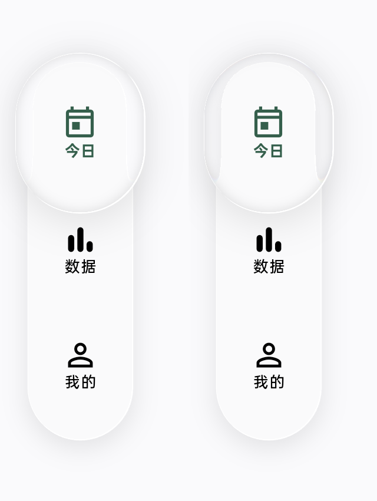

# 玻璃滑块内的导航栏阴影

2026-10-31，Pad 正式包构建号 **34**。按住或拖动凸起滑块时，导航栏映像现在包含栏体原有的投影；不增加滑块自身的重复阴影，不改变栏体、滑块尺寸与弹簧参数。

原绘制顺序将栏体和滑块的投影都放在两次背景采样之后，因此滑块只能折射没有阴影的栏体。现在顺序为：页面 → 栏体材质 → 栏体外阴影 → 滑块光学采样 → 滑块自身外阴影 → 字形。栏体仍采样干净页面；栏体投影只进入后续滑块映像，滑块投影留在自身采样之后，避免反馈累积。

`NavigationBarShadow` 沿用原栏体的颜色、4 dp 偏移和 8 dp 模糊，不添加额外加深；`NavigationLensShadow` 保留滑块原投影及其内部排除区域。原生 shader 与 OHOS 当前帧采样共用相同顺序；兼容材质也在两个独立裁切／采样阶段之间绘制栏体投影，避免联合裁切把投影切掉。

截图来自 OPD2401 真机正式 App，只裁剪导航区域。右图可见滑块内的栏体边缘投影，页面、栏体与字形位置不变。手势结束后已取消拖动并返回今日页；没有创建学习记录或清除数据。

## 验证

- 16 项导航交互、键盘避让、横竖屏布局回归通过。
- `navigation_shadow_test.dart` 在 Android API 36 ARM64 模拟器的真实 Impeller OpenGLES 后端通过，覆盖底部／侧边导航和浅／深主题四组场景。每组固定几何，比较有／无栏体投影，再比较保留帧，截图由原生窗口采集。
- 滑块内新增变暗采样点分别为 1339、1223、1181、1075（按 1 dp 网格采样）；四组连续帧的平均差均为 0，滑块外的栏体正文采样点保持不变。详见 [metrics.json](metrics.json)。
- 标准 SDK 静态检查没有新增错误或警告，仅保留既有 `axisAlignment` 和扫码 Web 类型检查两项 info。
- ARM64 Release 构建成功，以相同签名覆盖安装至 Pad，读取包信息确认 `versionCode=34`，原始安装时间保留。未在用户 Pad 上安装测试包；光学测试在独立模拟器运行。

本轮没有重新执行 iOS／鸿蒙设备验收；改动在共用组件，两个开发分支保持同一源码。原始窗口截图、测试日志、模拟器截图及正式 APK 存放在忽略的 `work/pad-navigation-2026-10-31/`。
