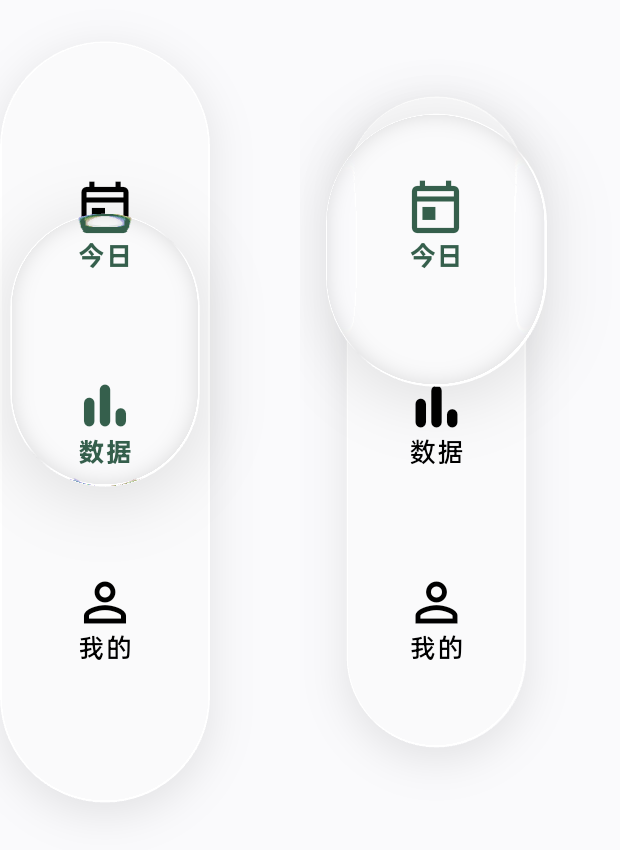

# Pad 侧边导航按压比例

OPD2401（Android 16／API 36）真机的横屏侧边导航，按压时栏体原来放大 25%，滑块反而比栏体窄。问题来自栏体用短边宽度归一化放大量，而滑块横向厚度仍沿用 56 dp 底部导航的常数。

现在按导航长轴归一化栏体放大，侧边栏按压稳定值从 1.25 降至 1.069；滑块按当前短轴的可用厚度计算，保留与底部导航相同的 1.08 基础比例及按压弹簧。侧边栏按住时，栏体厚约 68.41 dp、滑块厚约 84.24 dp，滑块向两侧各突出约 7.91 dp。数字来自组件几何，实际边缘还受光学折射与像素取整影响。

底部导航的几何参数和按压比例保持不变。侧边导航的左侧边距从 8 dp 增至 20 dp，并同步调整内容避让与键盘退出行程，为滑块及速度形变留出空间，避免屏幕左侧裁切。

截图由相同 Pad 的正式应用通过系统截屏采集，只裁剪导航区域；前后停留的滑块位置不同，比较对象为栏体和透镜的横向宽度。右图可见透镜两侧均超出栏体，且没有屏幕边缘裁切。截图不替代完整光学像素验收。

16 项导航交互、布局和键盘避让回归通过，覆盖横竖轴、RTL、反向拖动和取消；新增断言要求栏体增幅低于 8%、滑块／栏体短轴比例在 1.18–1.28，侧边透镜两侧各突出超过 5 dp。标准 SDK 静态检查只有两项已有 info，无新增问题。

正式 ARM64 Release 构建号 **33** 已在 Pad 上以相同签名覆盖安装，原始安装时间保留；没有卸载、清除数据或创建学习记录。验收后取消拖动，停回今日页。手机未连接，本次没有更新手机；共用源码已提交并保持两个开发分支一致。

指标见 [metrics.json](metrics.json)。原始窗口截图、日志和 APK 留在忽略的 `work/pad-navigation-2026-10-31/`，没有提交页面数据。
